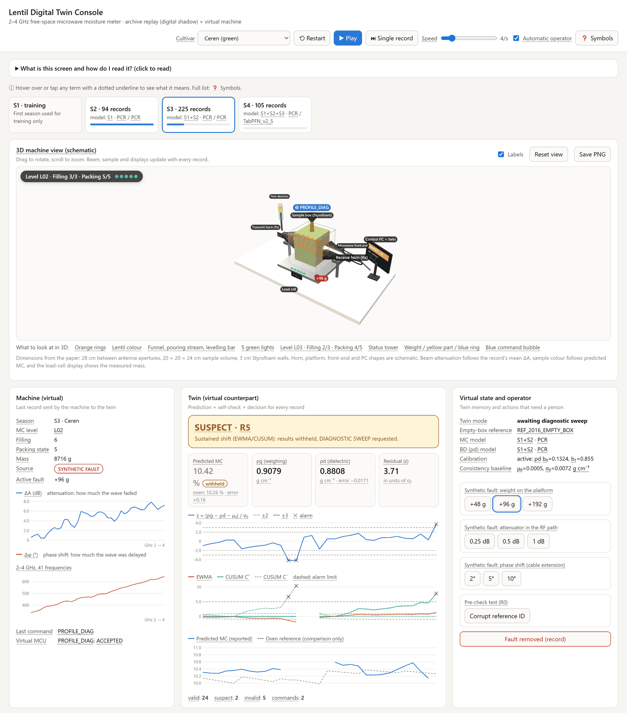

# Lentil Digital Twin

Digital twin console and measurement archive accompanying the article

> N. Çetin, K. Saçılık, E. Kavuncuoğlu, F. Auat Cheein. *Free-space microwave moisture sensing of lentils across four
> harvest seasons within a machine-level digital twin.* Manuscript in preparation.

A 2–4 GHz free-space microwave transmission system with an integrated load cell was used to predict the moisture
content (MC) of green (Ceren) and red (Çiftçi) lentils over four harvest seasons (S1–S4 = 2014–2017). This repository
provides the archive of the 979 measurement records, the Python code of the analyses reported in the article and an
interactive console that replays the records through the digital twin.



## Repository structure

```
├── analysis/                              Python code of the analyses (see analysis/README.md)
│   ├── step1_chronological_analysis.py    model tuning, freezing, transfer correction, evaluation
│   ├── step2_paper_tables_figures.py      tables and figures from the saved predictions
│   ├── step3_digital_shadow_evaluation.py residual monitoring and synthetic faults
│   ├── prepare_archive.py                 provenance of the merged archive
│   └── *.py, requirements.txt             modules used by the steps, package versions
├── digital_twin_console/
│   └── Lentil_Digital_Twin_Console.html   digital twin console (single offline file)
├── data/
│   ├── lentil_microwave_archive.csv       979 records × 41 frequencies
│   └── README.md                          data description and column dictionary
├── docs/images/                           figure used in this README
├── CITATION.cff                           citation metadata
└── THIRD_PARTY_NOTICES.md                 licence of the embedded Three.js library
```

## Quick start

1. Download the repository (**Code → Download ZIP**) and extract it, or download only
   `digital_twin_console/Lentil_Digital_Twin_Console.html`.
2. Double-click `Lentil_Digital_Twin_Console.html`. It opens in a current version of Chrome, Edge or Firefox; no
   installation or internet connection is needed.
3. Select a cultivar, press **Play** and tick **Automatic operator** to replay all seasons without stopping. Every
   dotted-underlined term has a tooltip, and the glossary at the bottom of the page explains all symbols.

## What the console shows

The archived records are sent to the twin one by one in measurement order, as if they were arriving from the machine.
For each record the twin

- predicts MC and the dielectric bulk density ρd (microwave inputs only, without the load cell);
- compares ρd with the gravimetric bulk density ρg through the residual score z = (ρg − ρd − μ₀)/σ₀, monitored with
  Shewhart, EWMA and CUSUM charts;
- decides whether the result is reported or withheld and, when required, issues a REPEAT, AVG or PROFILE_DIAG command
  (rules R0–R6, Table 3 of the article).

At the start of each incoming season a slope–bias correction fitted on two transfer MC levels is proposed and becomes
active only after approval. Synthetic faults can be added during the test records: a weight on the load cell (+48,
+96, +192 g), an attenuator in the RF path (0.25, 0.5, 1 dB) and a phase shift (2°, 5°, 10°). The **Predicted vs true
values** card compares the predictions with the oven MC and ρg, which the twin never sees, and exports a CSV file.

**Scope.** The console does not train or run any model. It contains the predictions of the models frozen in the
chronological analysis (each season predicted only with models trained on earlier seasons) for the fault-free records
and the nine preset faults, together with the season calibrations and consistency baselines. The model files are not
part of this repository; step 1 of the analysis code recreates them. The evaluated level is a **digital shadow**: data flow from the machine to the twin only.
Responses to the twin's commands are emulated from the archive by a virtual machine; they are not responses of the
physical machine.

## Analysis code

[`analysis/`](analysis/) contains the code that produced the results of the article, in three steps run from that
folder: the chronological analysis with 21 candidate models (Section 2.4), the tables and figures computed from its
saved predictions, and the digital shadow evaluation with synthetic faults (Section 2.3.2). Outputs are written to
`results/`. Requirements, run times, TabPFN licensing and random seeds are described in
[`analysis/README.md`](analysis/README.md).

## Data

The archive is described in [`data/README.md`](data/README.md): material, measurement procedure, column dictionary with
units, record counts and notes on how the level, filling and packing-state columns were reconstructed
(`analysis/prepare_archive.py`).

## Limitations

See also Sections 3.8, 4.5 and 4.7 of the article.

- In the fault-free replay of the S4 test records, the combined rule alarmed for 57 of 75 Ceren and 15 of 75 Çiftçi
  records; the residual baseline needs re-estimation at each new season (Section 3.8).
- Attenuation offsets are detected less reliably than weighing and phase offsets, because they shift z by less than
  one unit (Section 4.5).
- AVG and PROFILE_DIAG cannot be emulated from the archive; the virtual machine returns the same record.
- The archive has no time stamps; the replay order is season → cultivar → MC level → filling → packing state.

## How to cite

Please cite the article above; full citation details will be added on publication. Citation metadata for this
repository are given in [`CITATION.cff`](CITATION.cff).

## License

No license has been granted yet: all rights are reserved by the authors until a license file is added. The console
embeds Three.js r128 under the MIT License (see [`THIRD_PARTY_NOTICES.md`](THIRD_PARTY_NOTICES.md)).

## Authors

- **Necati Çetin**: Department of Agricultural Machinery and Technologies Engineering, Faculty of Agriculture, and
  Institute of Food Safety, Ankara University, Ankara, Türkiye
- **Kamil Saçılık**: Department of Agricultural Machinery and Technologies Engineering, Faculty of Agriculture, Ankara
  University, Ankara, Türkiye
- **Erhan Kavuncuoğlu**: Gemerek Vocational School, Cumhuriyet University, Sivas, Türkiye
- **Fernando Auat Cheein**: Department of Engineering, Harper Adams University, Newport, Shropshire, UK

Corresponding authors: Necati Çetin (nctcetin@ankara.edu.tr) and Erhan Kavuncuoğlu (ekavuncuoglu@cumhuriyet.edu.tr).

## Funding

This study was supported by the Scientific and Technological Research Council of Türkiye (TÜBİTAK) under grant number
113O433.
